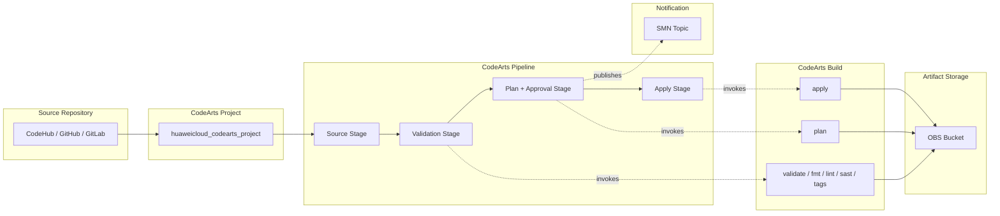

# deterministic-operations-terraform-pipeline / 华为云 CodeArts 流水线即代码（IaC 自举 IaC 流水线）

[](LICENSE)
[](https://support.huaweicloud.com/intl/en-us/)
[](#)

> Self-bootstrapped CI/CD pipeline for Terraform on Huawei Cloud
> 华为云 Terraform 流水线：用基础设施即代码（IaC）部署 IaC 流水线

---

## 1. Overview [CRITICAL]

**English**: This reference architecture delivers a **self-bootstrapped CI/CD pipeline for Terraform on Huawei Cloud** — the pipeline itself (pipeline definition, build jobs, artifacts bucket, IAM agencies, event triggers, notifications) is managed as code via Terraform. The pipeline environment becomes version-controlled, reproducible, and auditable.

Targeted at DevOps engineers, SRE, and platform engineering teams. Use it as a reference architecture, production template, or standardized deployment pattern across dev / staging / prod environments.

### Core Capabilities

- **Pipeline-as-code**: Pipeline configuration fully managed by Terraform, version-controlled
- **5-stage standard flow**: Source → Validation (4 parallel steps) → Plan → Approval → Apply
- **Multi-layer validation**: terraform validate / fmt / tflint / checkov SAST
- **Optional tag governance**: TagNAG consistency check
- **Observability**: LTS log group + SMN notifications (email / FunctionGraph / HTTP)
- **VPC-isolated builds**: CodeArts Build supports VPC networking
- **Multi-source**: CodeHub / GitHub / GitLab external repository integration

---

## 2. Table of Contents

- [1. Overview](#1-overview-critical)
- [2. Table of Contents](#2-table-of-contents)
- [3. Architecture Diagram](#3-architecture-diagram)
- [4. Highlights](#4-highlights)
- [5. Cloud Services Used](#5-cloud-services-used)
- [6. Prerequisites](#6-prerequisites-critical)
- [7. Quick Start](#7-quick-start-critical)
- [8. Step-by-Step Deployment](#8-step-by-step-deployment)
- [9. Usage / Verification](#9-usage--verification-critical)
- [10. Cleanup](#10-cleanup)
- [11. Detailed Explanation](#11-detailed-explanation)
- [12. Dependencies](#12-dependencies)
- [13. FAQ / Troubleshooting](#13-faq--troubleshooting)
- [14. Contributing](#14-contributing)
- [15. License](#15-license-critical)
- [16. Contact / Maintainers](#16-contact--maintainers-critical)

---

## 3. Architecture Diagram

> Self-bootstrapped CodeArts pipeline on Huawei Cloud: CodeArts Pipeline orchestrates 4 stages; CodeArts Build hosts 7 build jobs; OBS stores artifacts; IAM agencies authorize; LTS provides logs; SMN delivers email notifications.



**Key Components**:
- **CodeArts Pipeline**: 4-stage pipeline orchestration (Source / Validation / Plan / Approval / Apply)
- **CodeArts Build**: 7 independent build jobs (validate / fmt / lint / sast / tags / plan / apply)
- **OBS artifacts bucket**: KMS encryption + 90-day lifecycle + public access blocked + HTTPS-enforced
- **IAM agencies**: 3 agencies (codebuild_validate / codebuild_execution / eventbridge) for validation / execution / event roles separation
- **LTS log group**: centralized logs for build jobs and pipeline (TTL 90 days)
- **SMN notification**: pipeline status → email subscription

---

## 4. Highlights

- **Fully IaC-managed**: pipeline, build jobs, IAM agencies, OBS bucket, event triggers all managed by Terraform — no manual console operations
- **5-stage standardization**: Source → 4 parallel Validation steps → Plan + Manual Approval → Apply, following enterprise CI/CD best practices
- **4-dimensional static checks**: validate / fmt / lint / SAST layered for code quality
- **Optional tag governance**: enable TagNAG via `var.tags` to unify resource tagging
- **Flexible permission model**: 3 IAM agencies separate validation / execution / event roles, following least-privilege principle
- **VPC-isolated builds**: build jobs can run in specified VPC, accessing internal resources (e.g., private Registry)
- **Multi-source repository support**: CodeHub native + GitHub / GitLab external via OAuth / PAT
- **Complete observability**: LTS centralized logs + SMN email notifications, event-driven 7 build jobs

---

## 5. Cloud Services Used

| Service | Purpose | Notes |
|---|---|---|
| CodeArts Pipeline | Pipeline orchestration (4 stages) | Includes manual approval node |
| CodeArts Build | 7 build jobs | Supports VPC networking |
| CodeArts Project | Project container | Hosts pipeline and build jobs |
| Object Storage Service (OBS) | Artifacts bucket + encryption + lifecycle | 90-day expiry, HTTPS-enforced |
| Identity and Access Management (IAM) | 3 agency authorizations | Validation / execution / event separation |
| Key Management Service (KMS) | OBS server-side encryption | Optional, user-controlled |
| Log Tank Service (LTS) | Build job + pipeline logs | TTL 90 days |
| Simple Message Notification (SMN) | Pipeline status notification | Email subscription (no API fee) |
| EventGrid (EG) | Alternative event channel | When Pipeline triggers insufficient |

> **Note**: All services can be created with one-click via the Terraform in this repository. To clean up, see [Section 10 "Cleanup"](#10-cleanup).

---

## 6. Prerequisites [CRITICAL]

| Item | Requirement | Description |
|---|---|---|
| **Account** | Huawei Cloud account with real-name verification | Personal or enterprise account |
| **Permissions** | IAM **Tenant Administrator** or equivalent | To create CodeArts / OBS / IAM agencies / LTS / SMN / KMS / EG |
| **Region** | Recommended `cn-north-4` | CodeArts / OBS / LTS / SMN cross-region availability may differ |
| **Terraform** | `>= 1.5.7` | IaC deployment tool |
| **huaweicloud Provider** | `= 1.97.1` | Huawei Cloud Terraform Provider (locked to the local mirror version) |
| **SWR Image** | `swr.cn-north-4.myhuaweicloud.com/codeartsbuild/terraform:1.12.0` | Pre-push required; if missing, run `docker push` first |
| **AK/SK** | Get Access Key ID and Secret Access Key from the Huawei Cloud "My Credentials" page and fill them into the deployment script | **Do not** write credentials into any code or config file |

---

## 7. Quick Start [CRITICAL]

### One-click Deployment (Recommended)

```bash
# 1. Enter the deployment directory
cd deterministic-operations-terraform-pipeline/infra

# 2. Initialize Terraform
terraform init

# 3. Preview resource changes
terraform plan -out=tfplan

# 4. Apply deployment
terraform apply -auto-approve tfplan
```

> **Deployment time**: about 5–10 minutes (depending on CodeArts resource creation speed).
> **Full steps with expected output**: see [Section 8 "Step-by-Step Deployment"](#8-step-by-step-deployment).

---

## 8. Step-by-Step Deployment

### Step 1: Prepare terraform.tfvars

Create `terraform.tfvars` in `infra/` directory:

```hcl
region         = "cn-north-4"
project_name   = "default"
pipeline_name  = "myorg-pipeline"
repo           = "myorg/myrepo"
branch         = "main"
source_type    = "github"
connection_arn = "github-connection-arn"

# Optional: VPC networking
vpc = {
  vpc_id             = "vpc-xxxxxxxx"
  subnets            = ["subnet-xxxxxxxx"]
  security_group_ids = ["sg-xxxxxxxx"]
}

# Optional: SMN notification
notifications = {
  sns_topic   = "ops-team@example.com"
  events      = ["pipeline.failed", "pipeline.succeeded"]
  detail_type = "BASIC"
}
```

### Step 2: Initialize working directory

```bash
cd deterministic-operations-terraform-pipeline/infra
terraform init
```

**Expected output**: `Terraform has been successfully initialized!`

### Step 3: Preview resource changes

```bash
terraform plan -out=tfplan
```

**Expected output**: `Plan: N to add, 0 to change, 0 to destroy.`

### Step 4: Apply deployment

```bash
terraform apply -auto-approve tfplan
```

**Expected output**: `Apply complete! Resources: N added, 0 changed, 0 destroyed.`

### Step 5: Record key outputs

```bash
terraform output
```

**Expected output**: lists `pipeline_id` / `project_id` / `obs_artifacts_bucket` / `lts_log_group` / `smn_topic` field values.

---

## 9. Usage / Verification [CRITICAL]

> **Mandatory verification**: The commands and verification methods in this section have been listed by the agent with expected output and pass criteria before delivery. Please verify by following this section to confirm the business functionality works before considering the delivery complete.

### Verification 1: OBS artifacts bucket created

```bash
terraform output -json obs_artifacts_bucket
```

**Expected output**: contains `bucket` field with value `<pipeline_name>-artifacts-<account_id>`

### Verification 2: CodeArts project and pipeline created

```bash
# Console path: CodeArts → Project List → <pipeline_name>
# Or via CLI (requires hcloud CLI):
hcloud codearts project list --region cn-north-4
```

**Expected output**: project exists, type `scrum`, contains 1 pipeline

### Verification 3: Build jobs are ready

**Expected output**: console shows 7 jobs (validate / fmt / lint / sast / tags / plan / apply)

### Verification 4: LTS log group created

```bash
# Console: LTS → Log Groups → <pipeline_name>-logs
```

**Expected output**: 1 group (TTL 90 days) + 1 stream

### Verification 5: IAM agencies are ready

```bash
# Console: IAM → Agencies → list should contain 3
# Naming: <pipeline_name>-codebuild-validate / -codebuild-execution / -eventbridge
```

### Verification 6: Trigger pipeline (end-to-end)

In CodeArts console, select the pipeline → click "Run" → observe the 4-stage execution:

- **Source**: checkout code
- **Validation**: 4 parallel jobs (validate / fmt / lint / sast) all PASS
- **Plan**: plan job PASS
- **PlanApproval**: waiting for manual approval (click "Approve")
- **Apply**: apply job PASS

**Expected result**: pipeline overall PASS; OBS artifacts bucket has new `apply-{date}.zip` artifact; LTS logs contain full output for 7 jobs

---

## 10. Cleanup

```bash
# Enter the deployment directory
cd deterministic-operations-terraform-pipeline/infra

# Release all resources with one command
terraform destroy -auto-approve
```

**Expected output**: `Destroy complete! Resources: N destroyed.`

> **Avoid resource residue**:
> - `terraform destroy` only releases resources tracked in the Terraform state;
> - resources created directly via API during the process (e.g., manually uploaded OBS objects) must be released manually;
> - SWR images and CodeHub code are not managed by Terraform and need separate cleanup.

---

## 11. Detailed Explanation

### Workflow

```
[Source Code Push] → [CodeArts Pipeline triggers] → [Source Stage Checkout]
       ↓
[Validation Stage: 4 parallel jobs]
   ├─ validate (terraform validate)
   ├─ fmt (terraform fmt -check)
   ├─ lint (tflint --recursive)
   └─ sast (checkov -d . --framework terraform)
       ↓
[Plan Stage: plan build job + ManualReview approval]
       ↓
[Apply Stage: apply build job]
       ↓
[SMN notification → email subscription + OBS artifact upload + LTS log archive]
```

### Configuration Items

| Variable | Default | Description |
|---|---|---|
| `region` | `cn-north-4` | Huawei Cloud region |
| `pipeline_name` | (required) | Pipeline name |
| `repo` | (required) | Source code repository |
| `branch` | `main` | Source code branch |
| `source_type` | `codehub` | `codehub` / `github` / `gitlab` |
| `artifact_retention` | `90` | OBS artifacts bucket lifecycle expiry in days |
| `log_retention` | `90` | LTS log TTL in days |
| `build_timeout` | `10` | CodeArts Build job timeout in minutes |
| `terraform_version` | `1.12.0` | Terraform version (buildspec image version) |
| `checkov_version` | `3.2.0` | Checkov SAST version |
| `tflint_version` | `0.61.0` | TFLint version |
| `tagnag_version` | `0.7.9` | TagNAG version |
| `mode` | `SUPERSEDED` | Pipeline execution mode |
| `tags` | `""` | TagNAG tag check rule (empty string skips) |
| `vpc` | `null` | Build job VPC networking config (optional) |
| `notifications` | `null` | SMN notification config (optional) |

### Interfaces / APIs

- **CodeArts Pipeline API**: trigger via console or OpenAPI `POST /v3/{project_id}/pipelines`
- **OBS artifacts bucket**: access via `obs.cn-north-4.myhuaweicloud.com` with standard S3 SDK
- **SMN notification**: publish via `POST /v2/{topic_urn}/notifications`
- **LTS logs**: query via `GET /v2/{project_id}/groups/{group_id}/streams/{stream_id}/logs`

---

## 12. Dependencies

| Name | Version | Purpose |
|---|---|---|
| Terraform | `>= 1.5.7` | IaC orchestration |
| huaweicloud Provider | `= 1.97.1` | Huawei Cloud resources (locked to the local mirror version) |
| Terraform CLI / hcloud CLI | Latest stable | Local deployment and O&M |

---

## 13. FAQ / Troubleshooting

### Q1: What if deployment reports "insufficient permissions"?

**A**: Confirm the account has IAM **Tenant Administrator** permission, or at least sub-service admin permissions such as `CodeArts Administrator` / `OBS Administrator` / `IAM Administrator` / `LTS Administrator` / `SMN Administrator` / `KMS Administrator` / `EG Administrator`.

### Q2: What if huaweicloud_codearts_build_job reports image_address not found?

**A**: The image is not pre-pushed to SWR. First push the image in the SWR console (e.g., `docker push swr.cn-north-4.myhuaweicloud.com/codeartsbuild/terraform:1.12.0`), or modify `locals.validation_stages` to use an existing image.

### Q3: Why does Pipeline triggers not trigger the pipeline on push?

**A**: Check (1) CodeHub repository webhook is configured; (2) `connection_arn` / `repo` is correct; (3) `detect_changes` is true; (4) Console CodeArts → Settings → Integration has no unauthorized external repository connection.

### Q4: Why does EG custom event source not trigger?

**A**: EG custom channels do not automatically receive native cloud service events. The source must be explicitly mounted via `huaweicloud_eg_custom_event_source`; for CodeHub push, configure webhook in repository Settings → Webhooks pointing to EG channel endpoint.

### Q5: Why does ManualReview stay waiting forever?

**A**: Approver email is not configured. Modify `definition.stages[Plan].jobs[PlanApproval].inputs[approvers]` and fill in the actual approver email (same as `var.notifications.sns_topic`).

### Troubleshooting Checklist

| Symptom | Possible Cause | Troubleshooting |
|---|---|---|
| `terraform init` fails to fetch provider | Network restricted / mirror not configured | Configure `~/.terraformrc` `filesystem_mirror` pointing to local provider directory |
| `huaweicloud_identity_agency` reports agency domain not found | Wrong agency domain | Check actual domain in console (may differ across regions) |
| Pipeline triggered but build job does not start | build job name mismatch with Pipeline definition `jobId` | Check Pipeline `definition` JSON generated `jobId` field |
| OBS encryption failure | KMS key not authorized for OBS service | Console → KMS → Key → Authorization → add OBS service |
| Cross-region deployment failure | Some services only available in certain regions | Switch to `cn-north-4` (CodeArts primary region) |

---

## 14. Contributing

Issues and PRs are welcome. Please follow this process:

1. **Issue**: describe the problem / suggestion (with reproduction commands, expected / actual output, screenshots)
2. **PR**: create a feature branch from `main`; run `terraform validate` and `terraform fmt -check` before submitting
3. **Code Review**: merged after review by [@dgc-git](https://github.com/dgc-git)

---

## 15. License [CRITICAL]

This reference architecture is released under the **MIT No Attribution** license. See the [`LICENSE`](LICENSE) file at the repository root for details.

```
MIT No Attribution

Copyright (c) Huawei Cloud

Permission is hereby granted, free of charge, to any person obtaining a copy
of this software... (no attribution required)
```

---

## 16. Contact / Maintainers [CRITICAL]

| Item | Content |
|---|---|
| **Creator** | [@dgc-git](https://github.com/dgc-git) |
| **Maintainer** | [@dgc-git](https://github.com/dgc-git) |
| **Contact** | GitHub Issues / PR (see [Section 14](#14-contributing)) |

> Maintainer info is uniformly the GitHub account placeholder "<github-username>" and replaced with the real GitHub account before delivery; no team name / real name / email appears.
