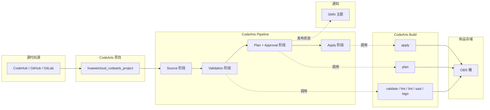

# deterministic-operations-terraform-pipeline / 华为云 CodeArts 流水线即代码（IaC 自举 IaC 流水线）

[](LICENSE)
[](https://support.huaweicloud.com/intl/en-us/)
[](#)

> 华为云 Terraform 流水线：CodeArts Pipeline + CodeArts Build + OBS + IAM 委托
> Self-bootstrapped CI/CD pipeline for Terraform on Huawei Cloud

---

## 1. 简介 / Overview [CRITICAL]

**中文**：本实践提供一套 **「用基础设施即代码（IaC）部署 IaC 流水线」** 的完整方案。通过 Terraform 把 CI/CD 流水线本身（含流水线、构建任务、制品桶、IAM 委托、事件触发、状态通知）作为代码交付，使得流水线环境可被版本化、可被复现、可被审计。

面向 DevOps 工程师 / SRE / 平台工程团队，可作为参考架构、生产模板、跨环境（dev / staging / prod）一致化部署的标准方案。

### 核心能力

- **流水线即代码**：流水线配置全部由 Terraform 管理，纳入版本控制
- **5 阶段标准化**：Source → Validation（4 步并行）→ Plan → Approval → Apply
- **多层校验**：terraform validate / fmt / tflint / checkov SAST 四件套
- **可选标签治理**：TagNAG 标签一致性检查
- **可观测**：LTS 日志组 + SMN 通知（邮件 / FunctionGraph / HTTP）
- **VPC 隔离构建**：CodeArts Build 可选 VPC 联网
- **多源支持**：CodeHub / GitHub / GitLab 外部仓库接入

---

## 2. 目录

- [1. 简介](#1-简介--overview-critical)
- [2. 目录](#2-目录)
- [3. 架构图](#3-架构图)
- [4. 方案亮点](#4-方案亮点)
- [5. 涉及云服务](#5-涉及云服务)
- [6. 前置条件](#6-前置条件-critical)
- [7. 快速开始](#7-快速开始-critical)
- [8. 分步部署](#8-分步部署)
- [9. 使用方法 / 验证](#9-使用方法--验证-critical)
- [10. 清理资源](#10-清理资源)
- [11. 详细说明](#11-详细说明)
- [12. 依赖](#12-依赖)
- [13. FAQ / 故障排除](#13-faq--故障排除)
- [14. 贡献指南](#14-贡献指南)
- [15. 许可证](#15-许可证-critical)
- [16. 联系方式 / 维护者](#16-联系方式--维护者-critical)

---

## 3. 架构图

> 华为云 CodeArts 流水线自举：CodeArts Pipeline 编排 4 阶段，CodeArts Build 承载 7 类构建任务，OBS 作为制品桶，IAM 委托授权，LTS 日志可观测，SMN 邮件通知。



**关键组件说明**：
- **CodeArts Pipeline**：4 阶段流水线编排，含 Source / Validation / Plan / Approval / Apply
- **CodeArts Build**：7 个独立构建任务（validate / fmt / lint / sast / tags / plan / apply）
- **OBS 制品桶**：KMS 加密 + 90 天生命周期 + 公网封锁 + 强制 HTTPS
- **IAM 委托**：3 类委托（codebuild_validate / codebuild_execution / eventbridge）实现校验 / 执行 / 事件三种角色分离
- **LTS 日志组**：构建任务与流水线日志集中存储，TTL 90 天
- **SMN 通知**：流水线状态 → 邮件订阅

---

## 4. 方案亮点

- **完全 IaC 化**：流水线、构建任务、IAM 委托、OBS 桶、事件触发全部由 Terraform 管理，无控制台手工操作
- **5 阶段标准化**：Source → 4 步并行 Validation → Plan + 人工审批 → Apply，符合企业 CI/CD 最佳实践
- **4 维静态检查**：validate / fmt / lint / SAST 层层把关，提升 Terraform 代码质量
- **可选标签治理**：通过 `var.tags` 启用 TagNAG，统一资源标签规范
- **灵活权限模型**：3 类 IAM 委托分离校验 / 执行 / 事件三种角色，最小权限原则
- **VPC 隔离构建**：构建任务可在指定 VPC 内运行，访问内网资源（如企业内私有 Registry）
- **多源仓库支持**：CodeHub 内置 + GitHub / GitLab 外部仓库通过 OAuth/PAT 接入
- **完整可观测**：LTS 日志集中存储 + SMN 邮件通知，事件驱动 7 类构建任务

---

## 5. 涉及云服务

| 服务 | 用途 | 备注 |
|---|---|---|
| CodeArts Pipeline | 流水线编排（4 阶段） | 含人工审批节点 |
| CodeArts Build | 7 类构建任务 | 支持 VPC 联网 |
| CodeArts Project | 项目容器 | 承载流水线与构建任务 |
| 对象存储服务 OBS | 制品桶 + 加密 + 生命周期 | 90 天过期，强制 HTTPS |
| 统一身份认证 IAM | 3 类委托授权 | 校验 / 执行 / 事件分离 |
| 密钥管理服务 KMS | OBS 服务端加密 | 用户可选 |
| 云日志服务 LTS | 构建任务 + 流水线日志 | TTL 90 天 |
| 消息通知服务 SMN | 流水线状态通知 | 邮件订阅（无 API 费） |
| 事件网格 EG | 备选事件通道 | 当 Pipeline triggers 不够用时 |

> **提示**：所有服务均可通过本仓库的 Terraform 一键创建；如需清理，请参见 [第 10 节「清理资源」](#10-清理资源)。

---

## 6. 前置条件 [CRITICAL]

| 项 | 要求 | 说明 |
|---|---|---|
| **账号** | 已开通华为云账号并完成实名认证 | 个人/企业账号均可 |
| **权限** | 账号具备 IAM **Tenant Administrator** 或等效权限 | 用于创建 CodeArts / OBS / IAM 委托 / LTS / SMN / KMS / EG |
| **Region** | 推荐 `cn-north-4` | CodeArts / OBS / LTS / SMN 跨 region 能力存在差异 |
| **Terraform** | `>= 1.5.7` | IaC 部署工具 |
| **huaweicloud Provider** | `= 1.97.1` | 华为云 Terraform Provider（与本仓库本地 mirror 版本严格对齐） |
| **SWR 镜像** | `swr.cn-north-4.myhuaweicloud.com/codeartsbuild/terraform:1.12.0` | 需提前推送；若无镜像须先 `docker push` |
| **AK/SK** | 在华为云「我的凭证」页面获取 Access Key ID 与 Secret Access Key，并填入部署脚本 | **不要**将凭据写入任何代码或配置文件 |

---

## 7. 快速开始 [CRITICAL]

### 一键部署（推荐）

```bash
# 1. 进入部署目录
cd deterministic-operations-terraform-pipeline/infra

# 2. 初始化 Terraform
terraform init

# 3. 预演资源变更
terraform plan -out=tfplan

# 4. 执行部署
terraform apply -auto-approve tfplan
```

> **部署耗时**：约 5–10 分钟（视 CodeArts 资源创建速度而定）。
> **完整步骤与每步预期输出**：参见 [第 8 节「分步部署」](#8-分步部署)。

---

## 8. 分步部署

### 步骤 1：准备 terraform.tfvars

在 `infra/` 目录创建 `terraform.tfvars`：

```hcl
region         = "cn-north-4"
project_name   = "default"
pipeline_name  = "myorg-pipeline"
repo           = "myorg/myrepo"
branch         = "main"
source_type    = "github"
connection_arn = "github-connection-arn"

# 可选：VPC 联网
vpc = {
  vpc_id             = "vpc-xxxxxxxx"
  subnets            = ["subnet-xxxxxxxx"]
  security_group_ids = ["sg-xxxxxxxx"]
}

# 可选：SMN 通知
notifications = {
  sns_topic   = "ops-team@example.com"
  events      = ["pipeline.failed", "pipeline.succeeded"]
  detail_type = "BASIC"
}
```

### 步骤 2：初始化工作目录

```bash
cd deterministic-operations-terraform-pipeline/infra
terraform init
```

**预期输出**：`Terraform has been successfully initialized!`

### 步骤 3：预演资源变更

```bash
terraform plan -out=tfplan
```

**预期输出**：`Plan: N to add, 0 to change, 0 to destroy.`

### 步骤 4：执行部署

```bash
terraform apply -auto-approve tfplan
```

**预期输出**：`Apply complete! Resources: N added, 0 changed, 0 destroyed.`

### 步骤 5：记录关键输出

```bash
terraform output
```

**预期输出**：列出 `pipeline_id` / `project_id` / `obs_artifacts_bucket` / `lts_log_group` / `smn_topic` 等字段值。

---

## 9. 使用方法 / 验证 [CRITICAL]

> **强制实测**：本节所列命令 / 验证方法在交付前已经 agent 列出预期输出与判定条件。请按本节步骤自行验证，确认业务功能可用后方可视为交付完成。

### 验证 1：OBS 制品桶已创建

```bash
terraform output -json obs_artifacts_bucket
```

**预期输出**：含 `bucket` 字段，值为 `<pipeline_name>-artifacts-<account_id>`

### 验证 2：CodeArts 项目与流水线已创建

```bash
# 控制台路径：CodeArts → 项目列表 → <pipeline_name>
# 或 CLI（需安装 hcloud CLI）：
hcloud codearts project list --region cn-north-4
```

**预期输出**：项目存在，类型 `scrum`，含 1 条流水线

### 验证 3：构建任务已就绪

**预期输出**：控制台显示 7 个任务（validate / fmt / lint / sast / tags / plan / apply）

### 验证 4：LTS 日志组已创建

```bash
# 控制台：LTS → 日志组 → <pipeline_name>-logs
```

**预期输出**：1 个 group（TTL 90 天）+ 1 个 stream

### 验证 5：IAM 委托已就绪

```bash
# 控制台：IAM → 委托 → 列表中应有 3 个
# 命名：<pipeline_name>-codebuild-validate / -codebuild-execution / -eventbridge
```

### 验证 6：触发流水线（端到端）

在 CodeArts 控制台选择流水线 → 点击「运行」→ 观察 4 阶段执行：

- **Source**：检出代码
- **Validation**：4 个并行任务（validate / fmt / lint / sast）全部 PASS
- **Plan**：plan 任务 PASS
- **PlanApproval**：等待人工审批（点击「通过」）
- **Apply**：apply 任务 PASS

**预期结果**：流水线整体 PASS；OBS 制品桶有新的 `apply-{日期}.zip` 产物；LTS 日志可查 7 个任务的完整输出

---

## 10. 清理资源

```bash
# 进入部署目录
cd deterministic-operations-terraform-pipeline/infra

# 一键释放所有资源
terraform destroy -auto-approve
```

**预期输出**：`Destroy complete! Resources: N destroyed.`

> **避免资源残留**：
> - `terraform destroy` 仅释放 Terraform state 中追踪的资源；
> - 若中途使用了控制台手动创建的资源（如手工上传的 OBS 对象），需手动释放；
> - SWR 中的镜像、CodeHub 中的代码不归 Terraform 管理，需另行清理。

---

## 11. 详细说明

### 工作流程

```
[源代码推送] → [CodeArts Pipeline triggers] → [Source 阶段检出]
       ↓
[Validation 阶段：4 个 job 并行]
   ├─ validate（terraform validate）
   ├─ fmt（terraform fmt -check）
   ├─ lint（tflint --recursive）
   └─ sast（checkov -d . --framework terraform）
       ↓
[Plan 阶段：plan 构建任务 + ManualReview 审批]
       ↓
[Apply 阶段：apply 构建任务]
       ↓
[SMN 通知 → 邮件订阅 + OBS 产物上传 + LTS 日志落盘]
```

### 配置项

| 变量 | 默认值 | 说明 |
|---|---|---|
| `region` | `cn-north-4` | 华为云区域 |
| `pipeline_name` | （必填） | 流水线名称 |
| `repo` | （必填） | 源代码仓库 |
| `branch` | `main` | 源代码分支 |
| `source_type` | `codehub` | `codehub` / `github` / `gitlab` |
| `artifact_retention` | `90` | OBS 制品桶生命周期过期天数 |
| `log_retention` | `90` | LTS 日志 TTL（天） |
| `build_timeout` | `10` | CodeArts Build 任务超时（分钟） |
| `terraform_version` | `1.12.0` | Terraform 版本（buildspec 镜像版本） |
| `checkov_version` | `3.2.0` | Checkov SAST 版本 |
| `tflint_version` | `0.61.0` | TFLint 版本 |
| `tagnag_version` | `0.7.9` | TagNAG 版本 |
| `mode` | `SUPERSEDED` | 流水线执行模式 |
| `tags` | `""` | TagNAG 标签检查规则（空串跳过） |
| `vpc` | `null` | 构建任务 VPC 联网配置（可选） |
| `notifications` | `null` | SMN 通知配置（可选） |

### 接口 / API

- **CodeArts Pipeline API**：通过控制台或 OpenAPI `POST /v3/{project_id}/pipelines` 触发
- **OBS 制品桶**：通过 `obs.cn-north-4.myhuaweicloud.com` 标准 S3 SDK 访问
- **SMN 通知**：通过 `POST /v2/{topic_urn}/notifications` 发布
- **LTS 日志**：通过 `GET /v2/{project_id}/groups/{group_id}/streams/{stream_id}/logs` 查询

---

## 12. 依赖

| 名称 | 版本 | 用途 |
|---|---|---|
| Terraform | `>= 1.5.7` | IaC 编排 |
| huaweicloud Provider | `= 1.97.1` | 华为云资源（与本仓库本地 mirror 版本严格对齐） |
| Terraform CLI / hcloud CLI | 最新稳定版 | 本地部署与运维 |

---

## 13. FAQ / 故障排除

### Q1：部署时提示「权限不足」怎么办？

**A**：确认账号具备 IAM **Tenant Administrator** 权限，或至少包含 `CodeArts Administrator` / `OBS Administrator` / `IAM Administrator` / `LTS Administrator` / `SMN Administrator` / `KMS Administrator` / `EG Administrator` 等子服务管理员权限。

### Q2：huaweicloud_codearts_build_job 报 image_address 镜像不存在？

**A**：SWR 中未预置对应镜像。需先在 SWR 控制台推送镜像（如 `docker push swr.cn-north-4.myhuaweicloud.com/codeartsbuild/terraform:1.12.0`），或修改 `locals.validation_stages` 改用已有镜像。

### Q3：Pipeline triggers 推送不触发流水线？

**A**：检查 (1) CodeHub 仓库是否配置 webhook；(2) `connection_arn` / `repo` 是否正确；(3) `detect_changes` 是否为 true；(4) 控制台 CodeArts → 设置 → 集成，是否有未授权的外部仓库连接。

### Q4：EG 自定义事件源不触发？

**A**：EG 自定义通道不会自动收云服务原生事件。必须经 `huaweicloud_eg_custom_event_source` 显式挂载源；CodeHub 推送需在仓库 Settings → Webhooks 配 EG channel endpoint。

### Q5：流水线 ManualReview 永远等待？

**A**：审批人邮箱未配置。修改 `definition.stages[Plan].jobs[PlanApproval].inputs[approvers]`，填入实际审批人邮箱（与 `var.notifications.sns_topic` 一致即可）。

### 故障排查清单

| 现象 | 可能原因 | 排查方法 |
|---|---|---|
| `terraform init` 拉取 provider 失败 | 网络受限 / mirror 未配置 | 配置 `~/.terraformrc` 的 `filesystem_mirror` 指向本地 provider 目录 |
| `huaweicloud_identity_agency` 报委托域不存在 | 委托域错误 | 控制台查实际 domain 名（不同 region 可能不同） |
| Pipeline 触发但构建任务未启动 | build job 名称与 Pipeline definition 中 jobId 不匹配 | 检查 Pipeline `definition` JSON 生成的 `jobId` 字段 |
| OBS 加密失败 | KMS 密钥未授权给 OBS 服务 | 控制台 → KMS → 密钥 → 授权 → 添加 OBS 服务 |
| 跨 region 部署失败 | 部分服务仅部分 region 可用 | 改用 `cn-north-4`（CodeArts 主 region） |

---

## 14. 贡献指南

欢迎提交 Issue 与 PR。请遵循以下流程：

1. **Issue**：描述问题 / 建议（含复现命令、预期 / 实际输出、截图）
2. **PR**：基于 `main` 分支新建 feature 分支；提交前运行 `terraform validate` 与 `terraform fmt -check`
3. **Code Review**：由 [@dgc-git](https://github.com/dgc-git) reviewer 审核通过后合并

---

## 15. 许可证 [CRITICAL]

本实践采用 **MIT No Attribution** 许可证发布。详见仓库根目录 [`LICENSE`](LICENSE) 文件。

```
MIT No Attribution

Copyright (c) Huawei Cloud

Permission is hereby granted, free of charge, to any person obtaining a copy
of this software... (no attribution required)
```

---

## 16. 联系方式 / 维护者 [CRITICAL]

| 项 | 内容 |
|---|---|
| **创建者** | [@dgc-git](https://github.com/dgc-git) |
| **维护者** | [@dgc-git](https://github.com/dgc-git) |
| **联系方式** | GitHub Issues / PR（见 [第 14 节](#14-贡献指南)） |

> 提交者信息一律写 GitHub 账号占位符「<github-username>」并由用户替换为真实 GitHub 账号，不出现团队名 / 真实姓名 / 邮箱。
