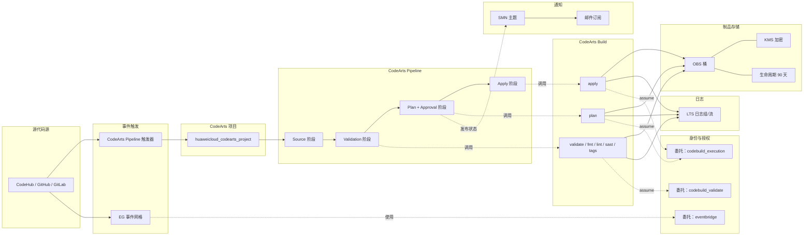

# 架构说明

## 1. 架构核心思想

本实践提供一套 **「用基础设施即代码（IaC）部署 IaC 流水线」** 的完整方案：通过 Terraform 把 CI/CD 流水线本身（含流水线、构建任务、制品桶、IAM 委托、事件触发、状态通知）作为代码交付，使得流水线环境可被版本化、可被复现、可被审计。

> 适用场景：企业需要在多个环境（dev / staging / prod）一致地部署 Terraform 自身的 CI/CD 流水线；流水线本身需要「自举」能力——把管理自身配置的代码也用流水线管理。

## 2. 架构图

## 3. 关键组件说明

| 组件 | 类型 | 职责 |
|---|---|---|
| CodeArts Pipeline | 编排 | 4 阶段流水线（Source / Validation / Plan / Apply），含人工审批节点 |
| CodeArts Build | 计算 | 7 类构建任务（validate / fmt / lint / sast / tags / plan / apply），按阶段挂载 |
| CodeArts Project | 容器 | 承载流水线与构建任务的逻辑项目 |
| OBS 制品桶 | 存储 | Terraform state 后端 / 构建产物 / 流水线制品；KMS 加密 + 90 天生命周期 |
| IAM 委托 | 授权 | 三类委托：codebuild_validate（只读）/ codebuild_execution（计划/应用，默认给足权限）/ eventbridge（EG 调用 Pipeline） |
| LTS 日志 | 可观测 | 流水线与构建任务日志，TTL 90 天 |
| EG 事件网格 | 事件 | CodeHub 推送 → CodeArts Pipeline 触发的备选通道（Pipeline triggers 为首选） |
| SMN 通知 | 通知 | 流水线状态（failed / succeeded）→ 邮件订阅 |
| KMS 密钥 | 安全 | OBS 制品桶的 SSE 加密（用户可选） |

## 4. 流水线阶段流程

### 阶段 1：Source
- **华为云实现**：huaweicloud_codearts_pipeline.sources + .triggers
- **支持源类型**：`codehub`（CodeHub 内置仓库）、`github` / `gitlab`（外部仓库，通过连接授权）
- **触发条件**：push 事件 / merge_request 事件

### 阶段 2：Validation（并行 4-5 步）
- **华为云实现**：huaweicloud_codearts_pipeline.definition.stages["Validation"].parallel = true，5 个 job 并行
- **步骤**：
  - **validate**：`terraform validate`
  - **fmt**：`terraform fmt -check -recursive`
  - **lint**：`tflint --recursive`
  - **sast**：`checkov -d . --framework terraform`（安全扫描）
  - **tags**（可选）：`tagnag --tags "..."`（当 `var.tags != ""` 启用）

### 阶段 3：Plan + 人工审批
- **华为云实现**：Plan stage 含 2 个 job
  - **TerraformPlan**：`official_devcloud_build` 调用 `codearts_build_job.plan`
  - **PlanApproval**：`official_devcloud_checkpoint` 任务，等待 `var.notifications.sns_topic` 审批

### 阶段 4：Apply
- **华为云实现**：Apply stage / 1 个 job
  - **TerraformApply**：`official_devcloud_build` 调用 `codearts_build_job.apply`

## 5. 事件驱动（EG）通道

华为云提供两条事件驱动路径：

### 路径 A：CodeArts Pipeline triggers（推荐）
- **资源**：`huaweicloud_codearts_pipeline.triggers`
- **优势**：CodeArts 内置，开箱即用，无需额外 EG 资源
- **限制**：仅支持 CodeHub / GitHub / GitLab 推送事件

### 路径 B：EG 事件网格（备选，OBS/CTS/SMN 等其他事件源）
- **资源**：`huaweicloud_eg_custom_event_source` + `huaweicloud_eg_subscription` + `huaweicloud_eg_target`
- **适用场景**：需要响应 OBS 桶变更、CTS 审计事件、SMN 告警等
- **配置步骤**：
  1. 在 CodeHub 仓库配置 webhook 推送到 EG channel
  2. EG 自定义源挂接 webhook 投递
  3. EG 订阅路由到 `huaweicloud_eg_target.invoke_pipeline`（provider=codearts）
- **已知坑位**：EG 自定义通道**不会自动收云服务原生事件**，必须经 `huaweicloud_eg_custom_event_source` 显式挂载源（`type`/`detail` 无完整文档，盲跑部署能过但告警静默不触发——按 `docs/01-service-mapping.md` 阶段 6 行注记）

## 6. IAM 委托模型

华为云 IAM 委托模型通过 `huaweicloud_identity_agency` + `delegated_domain_name` 实现：

| 委托名 | 资源类型 | delegated_domain | 用途 |
|---|---|---|---|
| `codebuild_validate` | `huaweicloud_identity_agency` | `op_svc_codearts` | 校验阶段任务：OBS 只读 + CodeArts Build Developer |
| `codebuild_execution` | `huaweicloud_identity_agency` | `op_svc_codearts` | 计划/应用任务：默认 `Tenant Administrator`（项目内全权限） |
| `eventbridge` | `huaweicloud_identity_agency` | `op_svc_eg` | EG 调用 Pipeline：CodeArts Pipeline Developer |
| `codepipeline` | `huaweicloud_identity_role` (type=AX) | — | CodeArts Pipeline 自定义操作的执行身份 |

## 7. 参数对照说明

> 本节描述本仓库 CodeArts Pipeline / Build / OBS / KMS / IAM / SMN / EG 的参数形态与典型取值；仅记录华为云侧行为。

| 参数位置 | 取值类型 | 行为说明 |
|---|---|---|
| `definition.pipeline.parallelism` | bool | 阶段并行开关；华为云仅布尔并行，无三选一；串行需求通过 `stage.sequence` 表达 |
| `definition.pipeline.version` | int (2) | 在 JSON 段标识流水线 schema 版本 |
| Build 报告组 | 内置于 build job | 不再独立资源；sast 结果由 build job 自身产出 |
| 事件源 | Pipeline triggers / EG 自定义源 | 见 §5 |
| OBS 加密 KMS | `huaweicloud_kms_key` 显式创建 | OBS 默认密钥非托管 KMS，建议显式建 |
| 委托域 | `agency.delegated_domain_name` + 业务侧策略 `Condition` | 条件由应用侧策略控制 |
| 构建规格 | `huaweicloud_codearts_build_job.flavor` (e.g. `build2s2.4u8g`) | 华为云规格字符串，需按 `huaweicloud_codearts_build_job` 文档取实际值 |
| 构建镜像 | `huaweicloud_codearts_build_job.image_address` (SWR 路径) | 需在 SWR 中预置 `codeartsbuild/terraform:1.x` 等镜像 |

## 8. 部署形态

支持两种部署模式：

### 模式 A：单环境自举
- `pipeline_name = "myorg-prod-pipeline"`
- 一条流水线管理生产环境
- artifacts 桶 = `myorg-prod-pipeline-artifacts-{account_id}`

### 模式 B：多环境串联（dev → staging → prod）
- 三条独立流水线，分别对应三个环境
- 每条流水线管理自己的环境，state 分别存放于不同的 OBS 桶
- 通过本仓库根的 `terraform.tfvars` 切换环境

## 9. 已知约束

- **CodeArts Build 镜像**：默认 SWR 镜像 `swr.cn-north-4.myhuaweicloud.com/codeartsbuild/terraform:1.12.0` 需提前推送到 SWR；如无对应版本，需修改 `locals.validation_stages` 与 `image_address`
- **CodeHub 仓库**：使用 `var.source_type = "codehub"` 时需先在 CodeArts 控制台创建对应仓库；Terraform 不创建仓库内容
- **GitHub / GitLab 外部源**：使用 `var.source_type = "github"` / `"gitlab"` 需在 CodeArts 控制台预授权 OAuth 或 Personal Access Token
- **EG 通道配置**：使用 `var.source_type != "codehub"` 时，`huaweicloud_eg_custom_event_source.codehub_push` 不会创建，需自行改用 Pipeline triggers 路径
- **VPC 联网**：`var.vpc` 为可选；当提供时需先建好 VPC / 子网 / 安全组，且子网需放通 SWR 端点访问
- **流水线执行模式**：`var.mode = "QUEUED"` 映射为 stage.sequence 串行，`PARALLEL` 映射为 stage.parallelism=true，`SUPERSEDED`（默认）= 旧版默认行为
